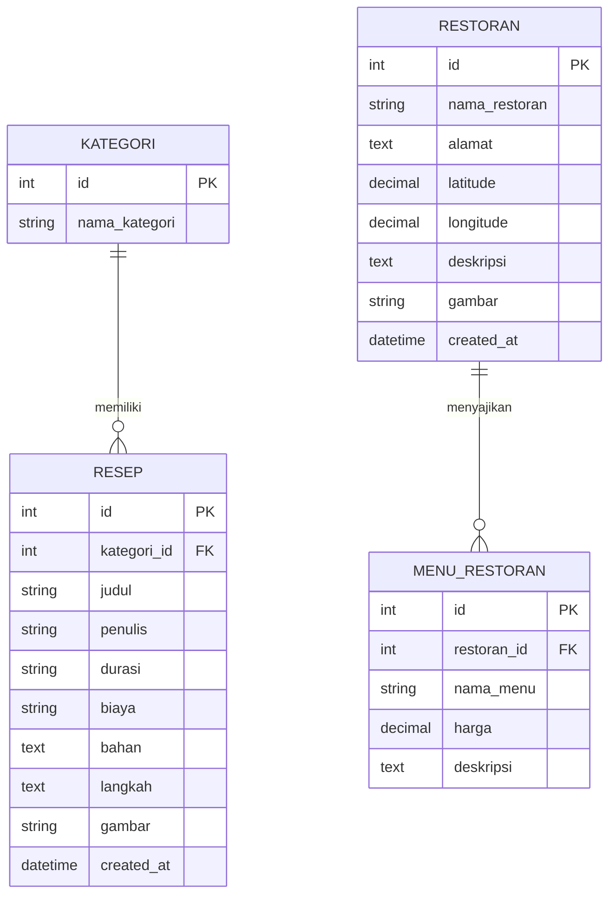

# Desain Database TempeKu

## 1. Entity Relationship Diagram (ERD)

## 2. Third Normal Form (3NF)

Desain database di atas sudah memenuhi standar **Third Normal Form (3NF)**:
1.  **1NF (First Normal Form)**: Setiap kolom memiliki nilai atomik (tidak ada array/list berulang di kolom sederhana, kecuali `bahan` dan `langkah` yang kita simpan sebagai format `TEXT` bersambung untuk mempermudah operasional web *document-style*, namun tidak melanggar 1NF dalam konteks teks utuh).
2.  **2NF (Second Normal Form)**: Semua tabel memiliki Primary Key (`id`), dan semua atribut non-key bergantung sepenuhnya pada Primary Key tersebut. (Tidak ada *partial dependency*).
3.  **3NF (Third Normal Form)**: Tidak ada *transitive dependency*. Semua atribut non-key hanya bergantung pada Primary Key, bukan pada atribut non-key lainnya. Contohnya, nama kategori dipisah ke tabel `KATEGORI` sehingga di tabel `RESEP` kita hanya menyimpan `kategori_id`, mencegah duplikasi teks kategori.

## 3. Rencana Migrasi & Seeder
- **Migrasi**: Membuat tabel `kategori`, `resep`, `restoran`, dan `menu_restoran`.
- **Seeder**: Memasukkan data awal (dummy data) seperti kategori "Gorengan", "Tumisan", serta beberapa contoh resep tempe dan restoran/warung tempe (beserta titik lokasi).
